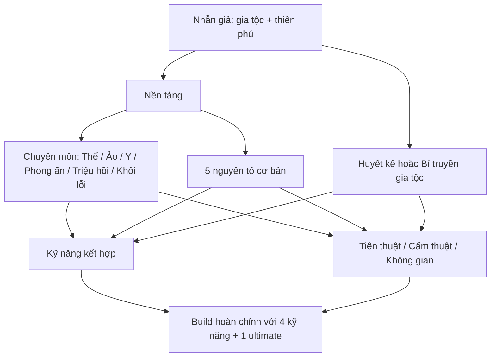

# SHINOBI EVOLUTION — Game Design Document (GDD) v1.0

**Thể loại:** PvPvE nhiều đội, sinh tồn bản đồ mở + nhịp đấu MOBA + RPG xây dựng nhân vật trong trận.  
**Trọng tâm:** Mỗi trận bắt đầu từ một xuất thân, phát triển thành nhiều build khác nhau thông qua nhánh kỹ năng, kinh nghiệm, Ryō và bí quyển tìm trong bản đồ.  
**Tài liệu kèm theo:** `naruto_skill_graph_v1.json` — dữ liệu mẫu gồm 162 nút, 29 nhóm cây, 12 cơ chế kết hợp.  
**Tình trạng:** Bản đề xuất cân bằng sơ bộ, không phải quy tắc chính thức của Naruto.

## 1. Ý tưởng trung tâm

**Gia tộc quy định cái bạn có thể thừa hưởng; chuyên môn quy định cái bạn có thể học; chiến trường quy định cái bạn có cơ hội khám phá.**

Trò chơi dùng *đồ thị kỹ năng có hướng* (skill graph) thay vì một cây cứng. Mỗi nút có điều kiện tiên quyết, vai trò chiến đấu, khóa theo gia tộc/huyết kế nếu cần, các kỹ năng cùng nhánh và các đầu nối lai nhánh. Một số nút có thể gắn vào nhiều build hoặc được mở từ nhiều hướng.

### Trải nghiệm mong muốn
- Trước trận: chọn gia tộc, thiên phú chakra ban đầu, chuyên môn ưa thích, 2 nhẫn thuật khởi điểm/1 nhẫn cụ, một bản thiết kế nhánh ưu tiên.
- Trong trận: farm quái, sự kiện, boss và nhiệm vụ lấy XP/Ryō/tư liệu; học các nút; va chạm đối thủ và chiếm điểm nóng.
- Cuối trận: build có bản sắc, kỹ năng cuối mạnh nhưng có cách khắc chế; giao tranh tranh đoạt ba khu phong ấn và hạch chiến trường.
- Trận mới: có thể chọn gia tộc và đường phát triển lại; thành tựu dài hạn mở lựa chọn ngang sức mạnh (cosmetic, preset, hiểu biết) chứ không tăng chỉ số bất công.

## 2. Ranh giới nguyên tác và sáng tạo gameplay

### Bám nguyên tác
- Phân loại Nhẫn thuật/Thể thuật/Ảo thuật, năm chakra cơ bản và quy tắc tương khắc.
- Rank E–S mô tả độ khó kỹ thuật, không đồng nhất với các mốc cấp nhân vật hay sát thương.
- Huyết kế giới hạn (Kekkei Genkai) khác bí thuật truyền dạy (Hiden).
- Sharingan là huyết kế Uchiha; Byakugan là huyết kế Hyūga. Kỹ thuật Nara, Yamanaka, Akimichi thuộc bí truyền (Hiden).
- Không phải mọi Sharingan đều tự có Thiên Chiếu; Mangekyō có bộ năng lực riêng theo từng người.
- Thổ + Thủy không tự tạo Mộc Độn; Phong + Thủy không tự tạo Băng Độn nếu thiếu huyết kế phù hợp.
- Tiên thuật cần học cách cảm nhận và cân bằng năng lượng tự nhiên; sử dụng sức mạnh cao có giới hạn hoặc đánh đổi.

### Những gì trò chơi tự thiết kế
- Quy tắc đánh rơi mảnh bí thuật, cửa ải/boss, công thức chiêu lai, thời gian hồi chiêu, diện tác động, giá Ryō.
- Một số nút như “Ảo ảnh trong sương”, “Lôi Nhu Quyền”, “Ảnh ấn phục kích”, “Trùng y thuật hỗ trợ” hoàn toàn là biến thể game, **không phải thuật nguyên tác**.
- Thức tỉnh nhãn thuật là sự kiện nhiệm vụ cảm xúc biểu trưng; không yêu cầu người chơi làm hại đồng đội hoặc thực hiện bi kịch cụ thể trong nguyên tác.

## 3. Cấu trúc kỹ năng



- **Nhóm 0 — Nền tảng:** Biến thân, Phân thân, Thế thân, kiểm soát chakra, chạy và dùng nhẫn cụ.
- **Nhóm 1 — Chuyên môn:** Thể thuật, Ảo thuật, Y thuật, Phong ấn, Khôi lỗi, Triệu hồi, Biến đổi hình thái chakra.
- **Nhóm 2 — Nguyên tố:** Hỏa, Phong, Lôi, Thổ, Thủy. Mỗi hệ có đường tấn công, kiểm soát, phòng thủ/cơ động. Các skill lai tạo tương tác.
- **Nhóm 3 — Gia tộc:** Uchiha, Hyūga, Nara, Yamanaka, Akimichi, Aburame, Inuzuka, Uzumaki, Yuki, Hōzuki.
- **Nhóm 4 — Nâng cao:** Tiên thuật, Bát Môn, cấm thuật, thuật không gian đặc biệt, một số huyết kế giới hạn cực hiếm.
- **Nhóm 5 — Cầu nối lai nhánh:** Kỹ năng được mở khi người chơi đã học đủ các nút trước đó.

## 4. Giai đoạn và ngân sách của một trận (đề xuất để playtest)

**Quy mô:** 6 đội × 3 người = 18 người, bản đồ có 4 vùng rìa và 1 tâm, 42 phút (có chế độ solo sau).  
**Cấp tối đa:** 20; **điểm mua nút chủ động:** tối đa 12 mỗi trận; 6 nền tảng khởi đầu được cấp tự động.  
**Trang bị kỹ năng:** 4 ô active, 1 ultimate, 3 passive, 1 nội tại gia tộc, 1 ô nhẫn cụ, 1 ô Thế thân riêng có hồi chiêu.  
**Cửa tầng đề xuất:** T0 từ lv1, T1 từ lv1, T2 từ lv4, T3 từ lv8, T4 từ lv12, T5 từ lv17.  
**Giới hạn sức mạnh:** chỉ trang bị 1 ultimate, một gói thức tỉnh chuyên biệt, tối đa 2 nguyên tố chủ lực (nguyên tố thứ ba chỉ từ sự kiện hiếm và giới hạn nhánh).

| Thời gian | Cấp tham chiếu | Trải nghiệm trọng tâm | Điểm nóng |
|---|---:|---|---|
| 0–7 phút | 1–5 | Quái yếu, làm quen, skill gốc | Trại quái/đường di chuyển |
| 7–15 phút | 5–9 | Nhánh đầu tiên, elite | Bí quyển phân nhánh |
| 15–27 phút | 9–14 | Lai hai nhánh, PvP theo đội | Khu di tích và boss |
| 27–36 phút | 14–18 | Đánh chiếm phong ấn, thưởng hiếm | Hầm bí thuật thế giới |
| 36–42 phút | 18–20 | Thức tỉnh, quyết chiến | Tâm bản đồ và hạch trận |

**Lưu ý:** Cấp trên là đường cong mục tiêu cho đội chơi tích cực, không phải cấp được bảo đảm theo thời gian.

## 5. Tài nguyên và học kỹ năng

### Tài nguyên
1. **XP:** chỉ để tăng cấp nhân vật, mở quyền học tier.
2. **Điểm kỹ năng (SP):** giới hạn số nút có thể học. Đề xuất 12 điểm theo các mốc cấp, các nút tầng 0 không tốn điểm.
3. **Ryō:** trả tiền học hoặc nâng cấp nội tại, mua nhẫn cụ, tái thiết kế một phần build.
4. **Tư liệu đặc biệt:** cuộn, ấn, mảnh khế ước; chủ yếu cấp *quyền mở* nhánh hoặc tạo biến thể, không trực tiếp cho lượng sát thương khổng lồ.

### Chi phí học tham chiếu

| Tầng | Cấp tối thiểu | SP | Ryō gợi ý | Khóa thông thường |
|---|---:|---:|---:|---|
| T0 | 1 | 0 | 0 | Mặc định |
| T1 | 1 | 1 | 100 | Chọn gia tộc/chuyên môn |
| T2 | 4 | 1 | 180 | Nút trước |
| T3 | 8 | 1 | 280 | Nút trước + có thể yêu cầu cuộn |
| T4 | 12 | 1 | 450 | Hai nhánh hoặc mini-boss |
| T5 | 17 | 1 | 700 | Sự kiện lớn, huyết kế hoặc tiên quyết đặc biệt |

Các giá này chỉ là *hạt giống thiết kế*, sẽ cần điều chỉnh theo thống kê XP/phút, vàng/phút và tỉ lệ thắng. Upgrade kỹ năng đã sở hữu có thể tăng mức hiệu quả qua Ryō nhưng bị giới hạn trần (ví dụ 3 cấp) để không thể mua thắng.

**Cơ chế rẽ nhánh:** mỗi tier có lựa chọn tấn công/kiểm soát/cơ động/phòng thủ. Trên UI, hiển thị nút chưa học, lý do bị khóa, nguồn vật phẩm gần nhất và lựa chọn thay thế không cần RNG.

## 6. Gia tộc: vai trò, cây chính, nhánh lai và phản khắc chế

| Gia tộc | Cội nguồn | Đường chính | Lai mạnh | Điểm yếu thực tế |
|---|---|---|---|---|
| **Uchiha** | Sharingan (huyết kế) | Quan sát → né đòn → ảo thuật / shuriken / Mangekyō | Thể thuật, Hỏa, Lôi | Chakra, kỹ năng gây mù tầm nhìn, hồi chiêu thức tỉnh |
| **Hyūga** | Byakugan (huyết kế) | Nhìn chakra → Nhu Quyền → 64 Chưởng / Hồi Thiên | Lôi, ấn chakra | Bị cấu rỉa từ xa, tấn công vào góc mù |
| **Nara** | Thuật bóng (Hiden) | Giữ bóng → khóa tay chân → ảnh đâm / mạng ảnh | Phong ấn, đồng đội dồn sát thương | Địa hình, chiếu sáng, giữ khoảng cách; người thi triển dễ bị phản công |
| **Yamanaka** | Tâm thuật (Hiden) | Nhập tâm → điều khiển / gây nhiễu → truyền tin | Trinh sát, phối hợp đội | Khi chuyển tâm, thân gốc cực kỳ rủi ro |
| **Akimichi** | Bội hóa (Hiden) | Bội hóa → tay lớn / lăn → cự thể / cánh bướm | Y thuật, Thổ | Thân to, dễ trúng đòn và bị kite |
| **Aburame** | Cộng sinh côn trùng | Gọi trùng → hút chakra / trinh sát → bão trùng | Truy dấu, bẫy | Sát thương diện rộng, thiêu đốt, mất bầy trùng |
| **Inuzuka** | Kết hợp nhẫn khuyển | Đánh hơi → Tứ Cước / thú nhân → Nha Thông Nha | Phong, trinh sát | Phải tiếp cận, bị vô hiệu hóa khi tách người/chó |
| **Uzumaki** | Sinh lực & truyền thống phong ấn | Chịu đòn → ấn → xích phong tỏa đặc thù | Y thuật, kết giới | Khởi chiêu chậm, ít cơ động; xích là thiên phú hiếm, không phổ cập |
| **Yuki** | Băng Độn (huyết kế) | Băng châm → tường băng → Ma Kính Băng Tinh | Thủy, Phong | Gương có thể bị phá, phụ thuộc kết giới |
| **Hōzuki** | Thủy Hóa (huyết kế) | Hóa lỏng → đạn nước → cơ động thủy hóa | Thủy, ám kích | Rất yếu trước Lôi Độn và khống chế hóa lỏng |

### Lưu ý cho thiết kế lâu dài
- **Senju:** Không tạo “người Senju nào cũng có Mộc Độn”. Nếu thêm, nên cho lợi thế linh hoạt/chakra, còn Mộc Độn là dấu ấn đặc thù kiểu Hashirama.
- **Kaguya:** Có thể ra mắt ở mùa sau với Shikotsumyaku (huyết kế xương), hợp build cận chiến chảy máu/giáp.
- **Kazekage/Từ Độn:** Không biến cát hay Từ Độn thành kỹ năng mọi nhân vật có thể học từ Thổ + Phong.
- **Jinchūriki:** Là trạng thái gắn với một vật chủ/vĩ thú, không phải nhánh gia tộc chung. Chỉ đưa vào sự kiện PvPvE có rủi ro rất cao hoặc chế độ riêng.

## 7. Ngũ Độn: mỗi hệ ba hướng phát triển

| Hệ | Nhánh sát thương | Nhánh khống chế | Nhánh phòng thủ / cơ động | Đối trọng |
|---|---|---|---|---|
| Hỏa | Hào Hỏa Cầu → Long Hỏa | Tường lửa → Hỏa vực | Phụng Tiên + nhẫn cụ tạo bẫy | Thủy có lợi thế |
| Phong | Phong nhận → Chân Không Ngọc | Phong áp → bão gió | Bộ pháp cuồng phong | Hỏa có lợi thế |
| Lôi | Lôi tiễn → Thiên Điểu / Lôi Thiết | Lôi chuỗi → trận địa lôi | Lôi giáp | Phong có lợi thế |
| Thổ | Thổ đạn → trói chân | Đầm lầy → thổ trận | Thổ Lưu Bích → thành đất / ẩn thổ | Lôi có lợi thế |
| Thủy | Thủy Đạn → Thủy Long | Thủy Lao → Vụ Ẩn | Thủy Trận Bích → thủy triều | Thổ có lợi thế |

**Chuỗi tương khắc chuẩn:** Hỏa khắc Phong → Phong khắc Lôi → Lôi khắc Thổ → Thổ khắc Thủy → Thủy khắc Hỏa.

**Gợi ý cơ chế khắc chế:** tương khắc chỉ nên tác động cường độ vừa phải khi hai nhẫn thuật va chạm trực diện, không cộng thẳng tỉ lệ thắng. Ví dụ một phản ứng môi trường: nước làm nền ướt, tạo điều kiện cho điện lan; Hỏa đốt cỏ thành tầm nhìn trống; Thổ dựng tường chặn thuật phóng; gió đẩy sương sang một góc. Các tương tác này là *cơ chế game* chứ không mặc nhiên là nhẫn thuật huyết kế mới.

## 8. 12 đầu nối lai (mẫu mở rộng)

| Nhánh phối hợp | Đầu vào | Đầu ra | Giới hạn |
|---|---|---|---|
| Hỏa + Phong | Hào Hỏa Cầu + Phong áp | Hỏa phong khuếch tán | Mở rộng vùng, giảm burst |
| Thủy + Lôi | Thủy Đạn + Lôi tiễn | Lôi thủy dẫn điện | Cần nền ướt trước |
| Thủy + Thổ | Thủy Đạn + đầm lầy | Thủy thổ bùn lầy | Không phải Mộc Độn |
| Phong + Nhẫn cụ | Phong nhận + shuriken | Phi tiêu có lưỡi gió | Tốn vật phẩm |
| Nara + Phong ấn | Bóng trói + phù | Ảnh ấn phục kích | Cần bố trí trước |
| Uchiha + Thể thuật | Sharingan 3 câu + combo | Nhãn thuật phản đòn | Cần né chuẩn nhịp |
| Hyūga + Lôi | Điểm huyệt + Lôi tiễn | Lôi Nhu Quyền | Kỹ năng game sáng tạo |
| Aburame + Y thuật | Trùng trinh sát + Chưởng Tiên | Trùng hỗ trợ | Hồi máu nhỏ |
| Khôi lỗi + Phong ấn | Rối độc + bùa | Rối đặt bẫy | Có thể phá bằng AoE |
| Phân thân + Phong ấn | Ảnh phân thân + bùa | Ảnh phân thân gài phù | Hao tài nguyên |
| Thủy + Ảo thuật | Vụ Ẩn + phân ảnh | Ảo ảnh trong sương | Trinh sát phát hiện |
| Cóc + Gió + Hỏa | Khế ước Cóc + Long Hỏa + Phong áp | Dầu hỏa phong cóc | Cần sự kiện/khế ước hiếm |

### Thiết kế **ba loại kết hợp** không được nhầm lẫn
1. **Phản ứng môi trường:** học hai nhánh thì có thể tạo ra tình huống phối hợp; không tự sinh huyết kế (ví dụ nước + điện).
2. **Kỹ năng lai chủ động:** mua hẳn một nút lai sau khi đã có hai nút nguồn; chiếm một ô kỹ năng (ví dụ bẫy bóng + phù).
3. **Huyết kế/cấm thuật đặc biệt:** phải có khóa huyết thống hoặc sự kiện riêng *ngoài* các nguyên tố nguồn (ví dụ Băng, Mộc, Phí, Trần Độn).

## 9. Hệ thống vật phẩm rơi và điều kiện mở khóa

### Bốn bậc chiến lợi phẩm

| Nguồn | Phần thưởng phổ biến | Chức năng |
|---|---|---|
| Quái thường | Ryō, XP, tinh thể chakra | Tăng tiến độ chắc chắn |
| Quái tinh anh | Mảnh bí quyển theo 1 trong 3 nhóm hợp build | Phá khóa T3/T4, người chơi có quyền chọn |
| Boss khu vực | Khế ước, ấn lĩnh ngộ, lõi địa hình | Kích hoạt nhánh lai hoặc ultimate không độc quyền |
| Boss thế giới / sự kiện tâm bản đồ | Vật phẩm thức tỉnh được công bố cho cả bản đồ | Nhánh đặc biệt T5, có tranh chấp PvP |

**Cơ chế may rủi có bảo hiểm:** Sau 4 lần hoàn thành mục tiêu cùng nhóm mà không nhận mảnh mong muốn, người chơi được **chọn một mảnh cùng nhóm**. Boss hiển thị trước nhóm phần thưởng (trinh sát, nhẫn thuật, phong ấn, huyết kế), tránh đánh ngẫu nhiên vô nghĩa.

**Ví dụ đồ rơi:**
- `Cuộn Hỏa Thuật` → cho phép học Hỏa nếu chưa có thiên phú.
- `Ký Ức Nhãn Thuật` → một điều kiện để kích hoạt Mangekyō của Uchiha (không cho ninja thường Sharingan).
- `Ấn Huyệt Đạo` → cho phép nâng cấp nhánh Nhu Quyền.
- `Linh Văn Phong Ấn` → mở đường kết hợp phong ấn.
- `Khế Ước Cóc` → mở nhánh triệu hồi cóc.
- `Tinh Hoa Tiên Lực` → là 1 trong nhiều điều kiện nhập Tiên thuật; không đủ để tự mở Tiên Nhân.
- `Mạch Huyết Kế` → tài nguyên cá nhân/hệ thống riêng có trạng thái tương thích, không đổi gia tộc người chơi ngẫu nhiên.

**Không nên:** drop ngay Rinnegan cho tất cả người chơi, “rơi Sharingan” như nhẫn cụ phổ thông, hoặc cuộn Mộc Độn cho mọi ai có Thủy+Thổ.

### Cạnh tranh vật phẩm công bằng
- Cơ hội cơ bản phải đến từ rèn luyện/chơi mục tiêu, **không ép người chơi phải đánh boss may rủi để có bất kỳ kỹ năng T4 nào**.
- Vật phẩm mở khóa hiếm cho phép mở một **nhánh lựa chọn**; sức mạnh phải còn cần SP/Ryō và điều kiện tiên quyết.
- Quái thường/elite không thể drop thẳng ultimate; boss thế giới phải báo trước ít nhất 3 phút, có đường tấn công từ nhiều phía.
- Đánh bại người chơi có thể cướp Ryō và vật tư *chưa sử dụng*; không xóa nhánh đã học trong trận.

## 10. Thiết kế bản đồ và nhịp PvPvE

```text
[Khu rừng / Trại thú] ------- [Di tích / Phong ấn A] ------- [Đầm sương]
             \                     |                       /
              \               [HẠCH TRẬN]                 /
               \                   |                     /
[Đồi đá / Công sự] -------- [Phong ấn B] -------- [Hang độc / rối]
                 \                |                   /
                       [Phong ấn C]
```

- **6 điểm xuất phát:** 6 đội xuất phát phân tán tương đối đối xứng.
- **Vòng PvE:** trại quái ở rìa cung cấp thu nhập ổn định, elite mở mảnh chọn nhánh.
- **Vòng giao tranh:** di tích, giếng chakra và 3 khu phong ấn tạo lý do để các đội gặp nhau, không cần đi săn người chơi vô tận.
- **Boss thế giới:** trung tâm hiện tín hiệu công khai; có 2–3 tuyến vào/ra và điểm chiếm giữ để tránh đội mạnh ôm mãi.
- **Giai đoạn cuối:** sương chakra/ấn phong tỏa thu hẹp các vùng farm, buộc đội còn sống đánh nhau gần tâm.

### Quy tắc thắng sơ bộ
Đội giành đủ **3 mảnh phong ấn** từ các mục tiêu, mang tới Hạch Trận và giữ quyền kiểm soát liên tục 120 giây sẽ thắng. Nếu hết 42 phút hoặc tâm bản đồ đóng, đội còn sống có điểm mục tiêu cao nhất thắng; tie-break là số mục tiêu, rồi điểm combat. Điều này tạo đường thắng cho đội kiểm soát chiến thuật chứ không chỉ đội nhiều mạng hạ gục.

### Sinh tồn nhưng không khiến người chết phải ngồi xem quá lâu
- Trước phút 24, bị hạ có thể được đồng đội cứu hoặc hồi sinh với một lượt giới hạn ở cứ điểm; học skill không mất, mất khoảng 10–15% Ryō chưa tiêu và một phần tư liệu chưa khóa.
- Từ phút 24, hồi sinh trở nên đắt/hiếm; từ phút 36 khóa hồi sinh để tạo cao trào sinh tồn.
- Người chơi yếu hơn có thể nhận điểm XP/Ryō phụ khi làm nhiệm vụ vùng ít được tranh chấp, nhưng không có buff sức mạnh vô lý.

## 11. Phản khắc chế và chống mất cân bằng

| Chiến thuật mạnh | Khắc chế phải tồn tại |
|---|---|
| Sharingan né/đọc đòn | Đòn diện rộng có báo trước, khóa tầm nhìn, tốn chakra khi bật mắt |
| Genjutsu khống chế | Giải ảo, đồng đội cứu, kháng liên tiếp có giảm hiệu quả |
| Nara khóa bóng | Phá đường nối bóng, cắt góc, gây áp lực lên người thi triển |
| Yamanaka nhập tâm | Thân gốc đứng yên/vulnerable, liên kết có thời gian tối đa |
| Hyūga khóa chakra | Giữ khoảng cách, chiêu tầm xa, góc mù, thoát giao tranh |
| Akimichi cự thể | Kiting, khống chế diện rộng, target lớn |
| Hōzuki hóa lỏng | Lôi, phong ấn, giới hạn thời gian hóa lỏng |
| Triệu hồi và phân thân | AoE, khắc chế triệu hồi, chia chakra/ngân sách thực thể |
| Tiên thuật/T5 | Cần tích năng lượng, hiệu ứng ngắn, dễ bị ngăn khi thi triển |

**Quy tắc CC:** cùng một mục tiêu nhận các lần trói/stun gần nhau sẽ giảm thời lượng tác dụng (diminishing returns), có cửa sổ miễn hiệu ứng ngắn, tránh combo không thể chơi. **Quy tắc thoát thân:** mỗi ninja luôn có Thế thân làm phanh an toàn, nhưng bị khống chế đúng thời điểm vẫn phải chịu rủi ro. **Quy tắc PvP:** nhẫn thuật mạnh phải có báo hiệu nhận diện, cách né hoặc phá, và tài nguyên tương xứng.

## 12. Ba ví dụ build và lộ trình

### Build A — Uchiha: Kiếm/Lôi/Sharingan (sát thủ phản đòn)
- Trước trận: Uchiha; thiên phú Lôi; chuyên môn Thể thuật; vũ khí kunai/kiếm ngắn.
- 0–7 phút: Sharingan một câu ngọc + Lôi tiễn + Thể thuật cơ bản.
- 7–15 phút: Sharingan hai câu + combo tay chân + tìm cuộn luyện Thiên Điểu.
- 15–27 phút: Sharingan ba câu + Thiên Điểu + mở nhãn thuật phản đòn (không bắt buộc).
- 27–36 phút: tìm `Ký Ức Nhãn Thuật` nếu muốn chơi Mangekyō, hoặc đầu tư Lôi Thiết/kiếm.
- 36–42 phút: chọn **một** gói Mangekyō thích hợp nếu đủ điều kiện; build khác của cùng Uchiha có thể bỏ hoàn toàn Mangekyō để tăng độ ổn định.
- Điểm yếu: thấp điểm khống chế, chiêu áp sát có hướng, sợ Thổ kết giới và nhẫn thuật diện rộng.

### Build B — Nara: Trói bóng + ấn bẫy (controller chiến thuật)
- Trước trận: Nara; thiên phú Thổ hoặc Phong; chọn chuyên môn Phong ấn.
- Đầu trận: Ảnh Chân Tự + bùa đặt bẫy.
- Giữa trận: kéo dài bóng → Ảnh Phược; lấy Linh Văn Phong Ấn, học Ảnh ấn phục kích.
- Cuối trận: mạng lưới ảnh + kết giới, biến vùng boss thành thế trận có lợi cho đồng đội.
- Điểm yếu: cực lệ thuộc góc đứng, mỏng manh nếu solo bị áp sát; sát thương một mình vừa phải.

### Build C — Yuki: Băng/Kết giới/Ảo thuật (zone-control)
- Trước trận: Yuki; huyết kế Băng; chọn Ảo thuật sơ cấp.
- Đầu trận: băng châm, phân ảnh ảo thuật.
- Giữa trận: băng tường, Vụ Ẩn nếu học được Thủy, hợp cùng Ảo thuật để giấu đường di chuyển.
- Cuối trận: Ma Kính Băng Tinh (huyết kế) kết hợp vùng sương để cô lập mục tiêu.
- Điểm yếu: tốn chakra, nhiều skill cần chuẩn bị địa hình, gương dễ bị tập trung phá.

## 13. Giao diện đồ thị kỹ năng

- **Trục ngang:** tier T0 đến T5; **trục dọc:** gia tộc, nguyên tố, chuyên môn, lai, thức tỉnh.
- **Đường nét liền:** bắt buộc có kỹ năng trước; **nét đứt:** điều kiện thay thế; **biểu tượng khóa:** gia tộc/huyết kế/boss/khế ước.
- **Nút mờ:** chưa đủ cấp; **nút đỏ tối:** trái huyết kế, không thể học trong build hiện tại; **viền sáng:** có vật phẩm mở; **nút đang phát triển:** học được ngay.
- Khi rê vào nút: hiển thị 5 trường đầu tiên: hiệu ứng, tốn chakra, hồi chiêu, yêu cầu, phản khắc chế; có nút xem toàn bộ nguồn và công thức.
- Có **Preset** trước trận (nhánh mục tiêu), nhưng cho phép đổi hướng trong trận; không khóa cứng lựa chọn ngay từ sảnh.

## 14. Mô hình dữ liệu kỹ thuật

Xem `naruto_skill_graph_v1.json`. Mỗi nút mẫu gồm:

```json
{
  "id": "FUSE_WATER_LIGHT",
  "name": "Lôi thủy dẫn điện",
  "tree": "Lai nhánh",
  "tier": 3,
  "requires_all": ["WATER_BULLET", "LIGHT_SPARK"],
  "requires_any": [],
  "unlock_gate": null,
  "combat_roles": ["khống chế"],
  "source_label": "game_design",
  "canonical_rank": null,
  "gameplay_effect": "Điện lan theo mặt nước đã tạo, không phải huyết kế"
}
```

**Nâng cấp schema khi vào sản xuất:** thêm `skill_point_cost`, `ryo_cost`, `cooldown_seconds`, `chakra_cost`, `duration_seconds`, `range_m`, `targeting_type`, `status_effects`, `element_tags`, `clan_requirement`, `bloodline_requirement`, `mutual_exclusion_group`, `equip_slot`, `max_upgrade_level`, `balance_patch_version`, `vfx_id`, `server_authoritative`, `icon_ref`. Phân biệt status runtime giữa `can_unlock`, `unlocked`, `equipped`, `temporarily_disabled`.

**Thuật toán mở khóa:** một nút được học khi (1) đủ cấp tier, (2) sở hữu toàn bộ `requires_all`, (3) thỏa mỗi nhóm `requires_any`, (4) đáp ứng `unlock_gate` và nhóm độc quyền, (5) đủ SP, Ryō, vật phẩm. Kiểm tra vòng lặp (cycle) trước khi phát hành. Server mới là nguồn kiểm tra điều kiện, không tin vào dữ liệu client.

### Chi phí performance cần dự kiến
- Phân thân, khôi lỗi, triệu hồi, trùng, vùng nước/điện và bẫy cần **server entity budget**. Ví dụ: mỗi người tối đa 1–2 triệu hồi vận hành thật và bầy trùng biểu diễn qua một vùng hiệu ứng, không spawn hàng nghìn actor riêng.
- Phản ứng môi trường sử dụng ô/volume có giới hạn thời gian và số lớp trạng thái; không mô phỏng từng hạt nước hay bóng thật theo pixel.
- Mỗi nhẫn thuật có ID và tags; tương tác định nghĩa theo tags, không hardcode mọi cặp 162×162.

## 15. Lộ trình triển khai

**Vertical slice (chơi được):** 3 gia tộc (Uchiha, Hyūga, Nara), 3 nguyên tố (Hỏa, Lôi, Thổ), Thể thuật + Phong ấn, 24–36 kỹ năng/nút, 2 phản ứng lai, 1 map nhỏ, 6–9 người. Đo được: thời gian ra skill T3/T4, gold/XP mỗi phút, tỉ lệ thắng build, thời gian giao tranh.

**Alpha:** 6 gia tộc, 5 nguyên tố, 60–80 nút, 8–12 người, 3 boss, 3 điểm phong ấn, có trận thắng hoàn chỉnh.

**Beta:** 10 gia tộc, 162 nút trong đồ thị mẫu, 18 người, tất cả nhánh nâng cao được cân bằng, thêm telemetry, giới hạn sức mạnh thức tỉnh, mỗi tuần thử thay đổi drop.

**Mở rộng sau ra mắt:** thêm gia tộc và chuyên môn bằng cách thêm node + tags + cổng unlock; ưu tiên mỗi nhánh mới có ít nhất 2 nút lai với đồ thị cũ. Mỗi bản cập nhật cân nhắc phản khắc chế trước khi ra sức mạnh mới.

## 16. Những câu hỏi thiết kế cần chốt sau prototype

1. Game thiên solo hay đội 3? Đề xuất đội 3 làm chế độ chính để nhánh hỗ trợ/Yamanaka/Nara có giá trị.
2. Người chơi điều khiển bằng PC action hoặc mobile? Khác biệt quyết định số ô kỹ năng, targeting và độ dài combo.
3. Giữ chết vĩnh viễn từ đầu hay hồi sinh giai đoạn đầu? Đề xuất hồi sinh hạn chế rồi khóa ở vòng cuối để giảm thời gian chết chờ.
4. Có thương mại hóa dưới tên Naruto hay chỉ lấy cảm hứng? Dùng tên, hình, âm thanh, kỹ năng có bản quyền trong sản phẩm phát hành thương mại cần quyền phù hợp.

## 17. Nguồn đối chiếu thế giới Naruto (không phải nguồn cho thông số game tự đề xuất)

- Naruto official — bài về năm loại chakra: https://naruto-official.com/en/news/01_2492
- Naruto official — Neji, Byakugan, Gentle Fist, 64 Chưởng: https://naruto-official.com/en/news/01_1296
- Naruto official — Shikamaru và bí thuật bóng: https://naruto-official.com/en/news/01_1910
- Naruto official — tu luyện Tiên thuật: https://naruto-official.com/en/news/01_1321
- Naruto official — Mangekyō có khả năng cá biệt và hao tổn thị lực: https://naruto-official.com/en/news/01_2424
- Naruto official — Hashirama dùng Mộc Độn và Tiên thuật: https://naruto-official.com/en/news/01_1627
- Naruto official — Yamanaka Tâm Truyền: https://naruto-official.com/en/news/01_2526
- Narutopedia — Phân loại jutsu/rank: https://naruto.fandom.com/wiki/Jutsu
- Narutopedia — Ngũ Độn: https://naruto.fandom.com/wiki/Nature_Transformation
- Narutopedia — Huyết kế giới hạn: https://naruto.fandom.com/wiki/Kekkei_Genkai
- Naruto Wiki — Hiden: https://naruto-wiki.com/wiki/hiden/

---

## PHỤ LỤC — Danh mục đầy đủ nút trong dữ liệu mẫu

> Bảng dưới liệt kê tất cả nút: T = Tier gameplay, **không phải cấp E–S của nguyên tác**. Tên kỹ năng sáng tạo có nhãn `[GAME]`; các kỹ năng có nguyên mẫu trong Naruto có nhãn `[NARUTO → GAMEPLAY]` vì đã được chỉnh hiệu ứng để chơi PvP.


### Aburame (5 nút)

| Tier | Mã | Kỹ năng | Tiên quyết | Điều kiện đặc biệt | Nhãn |
|---|---|---|---|---|---|
| T1 | `ABU_INSECT` | Kikaichū – côn trùng chakra | BASE_CHAKRA | Gia tộc Aburame, cộng sinh côn trùng | [NARUTO → GAMEPLAY] |
| T2 | `ABU_DRAIN` | Trùng hút chakra | ABU_INSECT | — | [NARUTO → GAMEPLAY] |
| T2 | `ABU_SCOUT` | Trinh sát bằng côn trùng | ABU_INSECT | — | [NARUTO → GAMEPLAY] |
| T3 | `ABU_COCOON` | Kén trùng phòng thủ | ABU_INSECT | — | [GAME] |
| T4 | `ABU_SWARM` | Bão trùng | ABU_DRAIN, ABU_SCOUT | — | [GAME] |

### Akimichi (5 nút)

| Tier | Mã | Kỹ năng | Tiên quyết | Điều kiện đặc biệt | Nhãn |
|---|---|---|---|---|---|
| T1 | `AKI_EXPAND` | Bội Hóa Thuật | BASE_CHAKRA | Gia tộc Akimichi hoặc truyền thụ Hiden hợp lệ | [NARUTO → GAMEPLAY] |
| T2 | `AKI_PART` | Bộ phận bội hóa | AKI_EXPAND | — | [NARUTO → GAMEPLAY] |
| T2 | `AKI_ROLL` | Nhục Đạn Chiến Xa | AKI_EXPAND, TAI_ROOT | — | [NARUTO → GAMEPLAY] |
| T3 | `AKI_MEGA` | Siêu Bội Hóa | AKI_PART | — | [NARUTO → GAMEPLAY] |
| T5 | `AKI_BUTTERFLY` | Chế độ Cánh Bướm | AKI_MEGA | Tu luyện đặc biệt hoặc bí dược có tác dụng phụ | [NARUTO → GAMEPLAY] |

### Chuyên môn Biến đổi hình thái (3 nút)

| Tier | Mã | Kỹ năng | Tiên quyết | Điều kiện đặc biệt | Nhãn |
|---|---|---|---|---|---|
| T2 | `SHAPE_ROOT` | Biến đổi hình thái chakra | BASE_CHAKRA | — | [NARUTO → GAMEPLAY] |
| T3 | `SHAPE_RASENGAN` | Rasengan | SHAPE_ROOT | Huấn luyện biến đổi hình thái | [NARUTO → GAMEPLAY] |
| T5 | `SHAPE_RASENSHURIKEN` | Phong Độn: Rasenshuriken | SHAPE_RASENGAN, WIND_SHURIKEN | Bí quyển kết hợp nâng cao và thử thách tinh luyện | [NARUTO → GAMEPLAY] |

### Chuyên môn Khôi lỗi (4 nút)

| Tier | Mã | Kỹ năng | Tiên quyết | Điều kiện đặc biệt | Nhãn |
|---|---|---|---|---|---|
| T1 | `PUP_ROOT` | Khôi lỗi cơ bản | BASE_WEAPON, BASE_CHAKRA | Học thuật điều khiển con rối | [NARUTO → GAMEPLAY] |
| T2 | `PUP_WEAPON` | Khôi lỗi nhẫn cụ | PUP_ROOT | — | [NARUTO → GAMEPLAY] |
| T3 | `PUP_POISON` | Khôi lỗi độc | PUP_WEAPON | Tìm độc dược hoặc luyện hóa | [NARUTO → GAMEPLAY] |
| T4 | `PUP_DUO` | Song khôi lỗi | PUP_WEAPON | — | [GAME] |

### Chuyên môn Phong ấn (4 nút)

| Tier | Mã | Kỹ năng | Tiên quyết | Điều kiện đặc biệt | Nhãn |
|---|---|---|---|---|---|
| T1 | `SEAL_ROOT` | Phong ấn sơ cấp | BASE_CHAKRA | Học từ thầy hoặc cuộn Phong ấn | [NARUTO → GAMEPLAY] |
| T2 | `SEAL_TRAP` | Bùa trói chakra | SEAL_ROOT | — | [GAME] |
| T3 | `SEAL_BARRIER` | Kết giới | SEAL_ROOT | — | [NARUTO → GAMEPLAY] |
| T4 | `SEAL_SUPPRESS` | Ấn áp chakra | SEAL_TRAP, SEAL_BARRIER | — | [GAME] |

### Chuyên môn Thể thuật (6 nút)

| Tier | Mã | Kỹ năng | Tiên quyết | Điều kiện đặc biệt | Nhãn |
|---|---|---|---|---|---|
| T1 | `TAI_ROOT` | Thể thuật cơ bản | BASE_MOVE | — | [NARUTO → GAMEPLAY] |
| T2 | `TAI_COMBO` | Liên hoàn quyền | TAI_ROOT | — | [GAME] |
| T3 | `TAI_GATE_1` | Bát Môn: Khai Môn | TAI_COMBO | Bí quyển rèn luyện Bát Môn | [NARUTO → GAMEPLAY] |
| T3 | `TAI_LOTUS` | Biểu Liên Hoa | TAI_COMBO | Huấn luyện tốc độ hoặc mở Bát Môn sơ bộ | [NARUTO → GAMEPLAY] |
| T4 | `TAI_GATE_3` | Bát Môn: Sinh Môn | TAI_GATE_1 | Ấn luyện thể cấp cao | [NARUTO → GAMEPLAY] |
| T5 | `TAI_GATE_6` | Bát Môn: Cảnh Môn | TAI_GATE_3 | Thử thách thể thuật cuối | [NARUTO → GAMEPLAY] |

### Chuyên môn Triệu hồi (5 nút)

| Tier | Mã | Kỹ năng | Tiên quyết | Điều kiện đặc biệt | Nhãn |
|---|---|---|---|---|---|
| T2 | `SUM_ROOT` | Khế ước triệu hồi | BASE_CHAKRA | Nhận khế ước từ phụ bản/nhân vật hướng dẫn | [NARUTO → GAMEPLAY] |
| T3 | `SUM_SLUG` | Triệu hồi sên | SUM_ROOT | Khế ước Sên | [NARUTO → GAMEPLAY] |
| T3 | `SUM_SNAKE` | Triệu hồi rắn | SUM_ROOT | Khế ước Rắn | [NARUTO → GAMEPLAY] |
| T3 | `SUM_TOAD` | Triệu hồi cóc | SUM_ROOT | Khế ước Cóc | [NARUTO → GAMEPLAY] |
| T5 | `SUM_GREAT` | Đại triệu hồi | SUM_ROOT; OR [['SUM_TOAD', 'SUM_SNAKE', 'SUM_SLUG']] | Hoàn thành thử thách của linh thú | [NARUTO → GAMEPLAY] |

### Chuyên môn Y thuật (5 nút)

| Tier | Mã | Kỹ năng | Tiên quyết | Điều kiện đặc biệt | Nhãn |
|---|---|---|---|---|---|
| T1 | `MED_ROOT` | Y thuật cơ bản | BASE_CHAKRA | Cuộn y thuật sơ cấp | [NARUTO → GAMEPLAY] |
| T2 | `MED_ANTIDOTE` | Giải độc | MED_ROOT | — | [NARUTO → GAMEPLAY] |
| T2 | `MED_PALM` | Chưởng Tiên Thuật | MED_ROOT | — | [NARUTO → GAMEPLAY] |
| T3 | `MED_PRECISION` | Dao mổ chakra | MED_PALM | — | [NARUTO → GAMEPLAY] |
| T4 | `MED_FIELD` | Trận địa y thuật | MED_PALM, MED_ANTIDOTE | — | [GAME] |

### Chuyên môn Ảo thuật (4 nút)

| Tier | Mã | Kỹ năng | Tiên quyết | Điều kiện đặc biệt | Nhãn |
|---|---|---|---|---|---|
| T1 | `GEN_ROOT` | Ảo thuật căn bản | BASE_CHAKRA | — | [NARUTO → GAMEPLAY] |
| T2 | `GEN_MIRAGE` | Phân ảnh ảo giác | GEN_ROOT, BASE_CLONE | — | [GAME] |
| T3 | `GEN_SNARE` | Ảo cảnh trói buộc | GEN_MIRAGE | — | [GAME] |
| T4 | `GEN_DOMAIN` | Mê trận cảm giác | GEN_SNARE | — | [GAME] |

### Hyūga (7 nút)

| Tier | Mã | Kỹ năng | Tiên quyết | Điều kiện đặc biệt | Nhãn |
|---|---|---|---|---|---|
| T1 | `HYG_EYE` | Byakugan | BASE_CHAKRA | Gia tộc Hyūga | [NARUTO → GAMEPLAY] |
| T2 | `HYG_GENTLE` | Nhu Quyền | HYG_EYE, TAI_ROOT | — | [NARUTO → GAMEPLAY] |
| T2 | `HYG_POINT` | Điểm huyệt chakra | HYG_GENTLE | — | [NARUTO → GAMEPLAY] |
| T3 | `HYG_64` | Bát Quái 64 Chưởng | HYG_POINT | — | [NARUTO → GAMEPLAY] |
| T3 | `HYG_AIRPALM` | Bát Quái Không Chưởng | HYG_GENTLE | — | [NARUTO → GAMEPLAY] |
| T3 | `HYG_ROTATION` | Bát Quái Hồi Thiên | HYG_EYE, HYG_GENTLE | — | [NARUTO → GAMEPLAY] |
| T4 | `HYG_LION` | Nhu Bộ Song Sư Quyền | HYG_64 | Cuộn lĩnh ngộ Nhu Quyền cao cấp | [NARUTO → GAMEPLAY] |

### Hōzuki (4 nút)

| Tier | Mã | Kỹ năng | Tiên quyết | Điều kiện đặc biệt | Nhãn |
|---|---|---|---|---|---|
| T1 | `HOZ_LIQUID` | Thủy Hóa Thuật | BASE_CHAKRA | Gia tộc Hōzuki | [NARUTO → GAMEPLAY] |
| T2 | `HOZ_WATERGUN` | Thủy Thiết Pháo | HOZ_LIQUID | — | [NARUTO → GAMEPLAY] |
| T3 | `HOZ_ESCAPE` | Hóa lỏng xuyên khe | HOZ_LIQUID | — | [GAME] |
| T4 | `HOZ_BODY` | Thủy hình bộc phát | HOZ_WATERGUN, HOZ_ESCAPE | — | [GAME] |

### Inuzuka (5 nút)

| Tier | Mã | Kỹ năng | Tiên quyết | Điều kiện đặc biệt | Nhãn |
|---|---|---|---|---|---|
| T1 | `INU_PARTNER` | Đồng hành nhẫn khuyển | BASE_MOVE | Gia tộc Inuzuka và nhẫn khuyển | [NARUTO → GAMEPLAY] |
| T2 | `INU_CLONE` | Thú Nhân Phân Thân | INU_PARTNER | — | [NARUTO → GAMEPLAY] |
| T2 | `INU_FOUR` | Tứ Cước Thuật | INU_PARTNER, TAI_ROOT | — | [NARUTO → GAMEPLAY] |
| T3 | `INU_FANG` | Nha Thông Nha | INU_FOUR, INU_CLONE | — | [NARUTO → GAMEPLAY] |
| T4 | `INU_WOLF` | Song Đầu Lang | INU_FANG | — | [NARUTO → GAMEPLAY] |

### Lai nhánh (15 nút)

| Tier | Mã | Kỹ năng | Tiên quyết | Điều kiện đặc biệt | Nhãn |
|---|---|---|---|---|---|
| T3 | `FUSE_FIRE_WIND` | Hỏa phong khuếch tán | FIRE_BALL, WIND_GUST | — | [GAME] |
| T3 | `FUSE_SHADOW_TRAP` | Ảnh ấn phục kích | NARA_BIND, SEAL_TRAP | — | [GAME] |
| T3 | `FUSE_WATER_EARTH` | Thủy thổ bùn lầy | WATER_BULLET, EARTH_BOG | — | [GAME] |
| T3 | `FUSE_WATER_LIGHT` | Lôi thủy dẫn điện | WATER_BULLET, LIGHT_SPARK | — | [GAME] |
| T3 | `FUSE_WIND_TOOL` | Phong nhận phi tiêu | WIND_BLADE, BASE_WEAPON | — | [GAME] |
| T4 | `FUSE_ABU_MED` | Trùng y thuật hỗ trợ | ABU_SCOUT, MED_PALM | — | [GAME] |
| T4 | `FUSE_BYAKU_LIGHT` | Lôi Nhu Quyền | HYG_POINT, LIGHT_SPARK | — | [GAME] |
| T4 | `FUSE_CLONE_SEAL` | Ảnh phân thân gài phù | BASE_SHADOWCLONE, SEAL_TRAP | — | [GAME] |
| T4 | `FUSE_EARTH_ABU` | Trùng ẩn thổ | ABU_DRAIN, EARTH_MOLE | — | [GAME] |
| T4 | `FUSE_EYE_KEN` | Nhãn thuật phản đòn | UCH_EYE3, TAI_COMBO | — | [GAME] |
| T4 | `FUSE_INU_WIND` | Nha Thông Nha cuồng phong | INU_FANG, WIND_STEP | — | [GAME] |
| T4 | `FUSE_PUP_POISON` | Khôi lỗi độc phong tỏa | PUP_POISON, SEAL_TRAP | — | [GAME] |
| T4 | `FUSE_SEAL_RASENGAN` | Rasengan gắn ấn | SHAPE_RASENGAN, SEAL_TRAP | — | [GAME] |
| T4 | `FUSE_WATER_MIST_GEN` | Ảo ảnh trong sương | WATER_MIST, GEN_MIRAGE | — | [GAME] |
| T5 | `FUSE_WIND_FIRE_TOAD` | Dầu hỏa phong cóc | SUM_TOAD, FIRE_DRAGON, WIND_GUST | Cuộn phối hợp linh thú hiếm | [NARUTO → GAMEPLAY] |

### Nara (6 nút)

| Tier | Mã | Kỹ năng | Tiên quyết | Điều kiện đặc biệt | Nhãn |
|---|---|---|---|---|---|
| T1 | `NARA_SHADOW` | Ảnh Chân Tự Thuật | BASE_CHAKRA | Gia tộc Nara hoặc truyền thụ Hiden hợp lệ | [NARUTO → GAMEPLAY] |
| T2 | `NARA_BIND` | Ảnh Thủ Trói Thuật | NARA_SHADOW | — | [NARUTO → GAMEPLAY] |
| T2 | `NARA_RANGE` | Kéo dài bóng | NARA_SHADOW | — | [GAME] |
| T3 | `NARA_NECK` | Ảnh Thủ Thắt Cổ | NARA_BIND | — | [NARUTO → GAMEPLAY] |
| T3 | `NARA_SEW` | Ảnh Phược Thuật | NARA_RANGE | — | [NARUTO → GAMEPLAY] |
| T4 | `NARA_MULTI` | Mạng lưới ảnh | NARA_SEW, NARA_BIND | — | [GAME] |

### Nguyên tố Hỏa (7 nút)

| Tier | Mã | Kỹ năng | Tiên quyết | Điều kiện đặc biệt | Nhãn |
|---|---|---|---|---|---|
| T1 | `FIRE_ROOT` | Hỏa Độn: khai mở | BASE_CHAKRA | Có thiên phú hoặc học quyển Hỏa Độn | [NARUTO → GAMEPLAY] |
| T2 | `FIRE_BALL` | Hào Hỏa Cầu | FIRE_ROOT | — | [NARUTO → GAMEPLAY] |
| T2 | `FIRE_PHOENIX` | Phụng Tiên Hỏa | FIRE_ROOT, BASE_WEAPON | — | [NARUTO → GAMEPLAY] |
| T3 | `FIRE_DRAGON` | Long Hỏa Thuật | FIRE_PHOENIX | — | [NARUTO → GAMEPLAY] |
| T3 | `FIRE_TRAP` | Hỏa ấn phục kích | FIRE_PHOENIX, BASE_TOOLWIRE | — | [GAME] |
| T3 | `FIRE_WALL` | Tường lửa | FIRE_BALL | — | [GAME] |
| T4 | `FIRE_ZONE` | Hỏa vực lan truyền | FIRE_WALL, FIRE_DRAGON | — | [GAME] |

### Nguyên tố Lôi (7 nút)

| Tier | Mã | Kỹ năng | Tiên quyết | Điều kiện đặc biệt | Nhãn |
|---|---|---|---|---|---|
| T1 | `LIGHT_ROOT` | Lôi Độn: khai mở | BASE_CHAKRA | Có thiên phú hoặc học quyển Lôi Độn | [NARUTO → GAMEPLAY] |
| T2 | `LIGHT_ARMOR` | Lôi giáp sơ cấp | LIGHT_ROOT, BASE_MOVE | — | [GAME] |
| T2 | `LIGHT_SPARK` | Lôi tiễn | LIGHT_ROOT | — | [GAME] |
| T3 | `LIGHT_CHAIN` | Lôi chuỗi | LIGHT_SPARK | — | [GAME] |
| T3 | `LIGHT_CHIDORI` | Thiên Điểu | LIGHT_ROOT, BASE_CHAKRA | Cuộn huấn luyện đột kích; nếu không có nhãn thuật cần cơ chế nhìn hướng đâm an toàn | [NARUTO → GAMEPLAY] |
| T4 | `LIGHT_FIELD` | Trận địa lôi | LIGHT_CHAIN, LIGHT_ARMOR | — | [GAME] |
| T4 | `LIGHT_RAIRI` | Lôi Thiết | LIGHT_CHIDORI | Thử thách tinh luyện Thiên Điểu | [NARUTO → GAMEPLAY] |

### Nguyên tố Phong (7 nút)

| Tier | Mã | Kỹ năng | Tiên quyết | Điều kiện đặc biệt | Nhãn |
|---|---|---|---|---|---|
| T1 | `WIND_ROOT` | Phong Độn: khai mở | BASE_CHAKRA | Có thiên phú hoặc học quyển Phong Độn | [NARUTO → GAMEPLAY] |
| T2 | `WIND_BLADE` | Phong nhận | WIND_ROOT | — | [NARUTO → GAMEPLAY] |
| T2 | `WIND_GUST` | Phong áp | WIND_ROOT | — | [GAME] |
| T3 | `WIND_SHURIKEN` | Shuriken phong chakra | WIND_BLADE, BASE_WEAPON | — | [NARUTO → GAMEPLAY] |
| T3 | `WIND_STEP` | Bộ pháp cuồng phong | WIND_GUST, BASE_MOVE | — | [GAME] |
| T3 | `WIND_VACUUM` | Chân Không Ngọc | WIND_BLADE | — | [NARUTO → GAMEPLAY] |
| T4 | `WIND_STORM` | Phong bạo | WIND_STEP, WIND_VACUUM | — | [GAME] |

### Nguyên tố Thổ (7 nút)

| Tier | Mã | Kỹ năng | Tiên quyết | Điều kiện đặc biệt | Nhãn |
|---|---|---|---|---|---|
| T1 | `EARTH_ROOT` | Thổ Độn: khai mở | BASE_CHAKRA | Có thiên phú hoặc học quyển Thổ Độn | [NARUTO → GAMEPLAY] |
| T2 | `EARTH_PROJECTILE` | Thổ đạn | EARTH_ROOT | — | [GAME] |
| T2 | `EARTH_WALL` | Thổ Lưu Bích | EARTH_ROOT | — | [NARUTO → GAMEPLAY] |
| T3 | `EARTH_BOG` | Đầm lầy bùn | EARTH_PROJECTILE | — | [NARUTO → GAMEPLAY] |
| T3 | `EARTH_GRAB` | Thổ trói chân | EARTH_BOG | — | [GAME] |
| T3 | `EARTH_MOLE` | Ẩn trong đất | EARTH_WALL, BASE_MOVE | — | [NARUTO → GAMEPLAY] |
| T4 | `EARTH_FORT` | Thành đất liên hoàn | EARTH_WALL, EARTH_BOG | — | [GAME] |

### Nguyên tố Thủy (7 nút)

| Tier | Mã | Kỹ năng | Tiên quyết | Điều kiện đặc biệt | Nhãn |
|---|---|---|---|---|---|
| T1 | `WATER_ROOT` | Thủy Độn: khai mở | BASE_CHAKRA | Có thiên phú hoặc học quyển Thủy Độn | [NARUTO → GAMEPLAY] |
| T2 | `WATER_BULLET` | Thủy Đạn | WATER_ROOT | — | [NARUTO → GAMEPLAY] |
| T2 | `WATER_WALL` | Thủy Trận Bích | WATER_ROOT | — | [NARUTO → GAMEPLAY] |
| T3 | `WATER_DRAGON` | Thủy Long Đạn | WATER_BULLET | — | [NARUTO → GAMEPLAY] |
| T3 | `WATER_MIST` | Vụ Ẩn | WATER_WALL | — | [NARUTO → GAMEPLAY] |
| T3 | `WATER_PRISON` | Thủy Lao Thuật | WATER_BULLET | — | [NARUTO → GAMEPLAY] |
| T4 | `WATER_SURGE` | Thủy triều | WATER_DRAGON, WATER_MIST | — | [GAME] |

### Nền tảng (14 nút)

| Tier | Mã | Kỹ năng | Tiên quyết | Điều kiện đặc biệt | Nhãn |
|---|---|---|---|---|---|
| T0 | `BASE_CHAKRA` | Kiểm soát chakra | — | — | [NARUTO → GAMEPLAY] |
| T0 | `BASE_CLONE` | Phân thân thuật | — | — | [NARUTO → GAMEPLAY] |
| T0 | `BASE_MOVE` | Bước chân ninja | — | — | [NARUTO → GAMEPLAY] |
| T0 | `BASE_SUB` | Thế thân thuật | — | — | [NARUTO → GAMEPLAY] |
| T0 | `BASE_TRANSFORM` | Biến thân thuật | — | — | [NARUTO → GAMEPLAY] |
| T0 | `BASE_WEAPON` | Nhẫn cụ sơ cấp | — | — | [NARUTO → GAMEPLAY] |
| T1 | `BASE_TOOLWIRE` | Bẫy dây thép | BASE_WEAPON | — | [GAME] |
| T1 | `BASE_WALL` | Bám tường | BASE_CHAKRA, BASE_MOVE | — | [NARUTO → GAMEPLAY] |
| T1 | `BASE_WATERWALK` | Đi trên mặt nước | BASE_CHAKRA | — | [NARUTO → GAMEPLAY] |
| T2 | `BASE_DODGE` | Thế thân tinh luyện | BASE_SUB, BASE_MOVE | — | [GAME] |
| T2 | `BASE_SENSOR` | Cảm nhận chakra sơ cấp | BASE_CHAKRA | — | [GAME] |
| T2 | `BASE_SHADOWCLONE` | Ảnh phân thân thuật | BASE_CLONE, BASE_CHAKRA | Cuộn Ảnh Phân Thân hoặc hoàn thành huấn luyện | [NARUTO → GAMEPLAY] |
| T2 | `BASE_THROW` | Phi tiêu phân thân | BASE_WEAPON, BASE_CLONE | — | [NARUTO → GAMEPLAY] |
| T4 | `BASE_MULTI_CLONE` | Đa trọng ảnh phân thân | BASE_SHADOWCLONE | Bí quyển cấm thuật và chỉ số chakra rất cao | [NARUTO → GAMEPLAY] |

### Uchiha (11 nút)

| Tier | Mã | Kỹ năng | Tiên quyết | Điều kiện đặc biệt | Nhãn |
|---|---|---|---|---|---|
| T1 | `UCH_EYE1` | Sharingan một câu ngọc | BASE_CHAKRA | Gia tộc Uchiha + thức tỉnh cơ bản | [NARUTO → GAMEPLAY] |
| T1 | `UCH_FIRE` | Tập quán Hỏa Độn Uchiha | UCH_EYE1 | — | [NARUTO → GAMEPLAY] |
| T2 | `UCH_EYE2` | Sharingan hai câu ngọc | UCH_EYE1 | Rèn luyện nhãn thuật | [NARUTO → GAMEPLAY] |
| T2 | `UCH_SHURIKEN` | Shurikenjutsu Uchiha | UCH_EYE2, BASE_WEAPON | — | [NARUTO → GAMEPLAY] |
| T3 | `UCH_COPY` | Sao chép nhẫn thuật phổ thông | UCH_EYE3 | — | [NARUTO → GAMEPLAY] |
| T3 | `UCH_EYE3` | Sharingan ba câu ngọc | UCH_EYE2 | Cuộn lĩnh ngộ Sharingan | [NARUTO → GAMEPLAY] |
| T3 | `UCH_GEN` | Ảo thuật Sharingan | UCH_EYE3, GEN_ROOT | — | [NARUTO → GAMEPLAY] |
| T5 | `UCH_FLAME` | Nhánh Mangekyō: Hắc viêm | UCH_MANGEKYO | Gói nhãn thuật hắc viêm hiếm, không mặc định cho Uchiha | [NARUTO → GAMEPLAY] |
| T5 | `UCH_MANGEKYO` | Mangekyō Sharingan | UCH_EYE3 | Ký ức thức tỉnh hiếm + nhiệm vụ áp lực tâm lý mang tính hư cấu, không yêu cầu hại đồng đội | [NARUTO → GAMEPLAY] |
| T5 | `UCH_SPACE` | Nhánh Mangekyō: Không gian | UCH_MANGEKYO | Gói nhãn thuật không gian hiếm, loại trừ gói hắc viêm | [NARUTO → GAMEPLAY] |
| T5 | `UCH_SUSANOO` | Susanoo chưa hoàn chỉnh | UCH_MANGEKYO | Đã mở Mangekyō ở cả hai mắt theo gói thức tỉnh | [NARUTO → GAMEPLAY] |

### Uzumaki (5 nút)

| Tier | Mã | Kỹ năng | Tiên quyết | Điều kiện đặc biệt | Nhãn |
|---|---|---|---|---|---|
| T1 | `UZU_VITAL` | Sinh lực Uzumaki | BASE_CHAKRA | Gia tộc Uzumaki | [NARUTO → GAMEPLAY] |
| T2 | `UZU_SEAL` | Di sản phong ấn Uzumaki | UZU_VITAL, SEAL_ROOT | — | [NARUTO → GAMEPLAY] |
| T3 | `UZU_REGEN` | Hồi phục sinh lực | UZU_VITAL, MED_ROOT | — | [NARUTO → GAMEPLAY] |
| T4 | `UZU_CHAIN` | Kim Cang Phong Tỏa | UZU_SEAL | Huyết thống tương thích hiếm và nhiệm vụ phong ấn | [NARUTO → GAMEPLAY] |
| T5 | `UZU_BARRIER` | Kết giới Kim Cang | UZU_CHAIN, SEAL_BARRIER | Hạch kết giới hiếm | [NARUTO → GAMEPLAY] |

### Yamanaka (5 nút)

| Tier | Mã | Kỹ năng | Tiên quyết | Điều kiện đặc biệt | Nhãn |
|---|---|---|---|---|---|
| T1 | `YAM_MIND` | Tâm Chuyển Thân Thuật | BASE_CHAKRA | Gia tộc Yamanaka hoặc truyền thụ Hiden hợp lệ | [NARUTO → GAMEPLAY] |
| T2 | `YAM_SIGNAL` | Tâm Truyền Thân | YAM_MIND | — | [NARUTO → GAMEPLAY] |
| T3 | `YAM_DISTURB` | Tâm Loạn Thân Thuật | YAM_MIND | — | [NARUTO → GAMEPLAY] |
| T3 | `YAM_SWITCH` | Tâm Chuyển Thân tầm xa | YAM_MIND | — | [GAME] |
| T4 | `YAM_NETWORK` | Mạng liên lạc tâm trí | YAM_SIGNAL, YAM_DISTURB | — | [GAME] |

### Yuki (4 nút)

| Tier | Mã | Kỹ năng | Tiên quyết | Điều kiện đặc biệt | Nhãn |
|---|---|---|---|---|---|
| T1 | `YUKI_ICE` | Băng Độn | BASE_CHAKRA | Huyết kế Yuki (không chỉ cần Thủy và Phong) | [NARUTO → GAMEPLAY] |
| T2 | `YUKI_NEEDLE` | Băng châm | YUKI_ICE | — | [GAME] |
| T3 | `YUKI_WALL` | Băng tường | YUKI_ICE | — | [GAME] |
| T4 | `YUKI_MIRROR` | Ma Kính Băng Tinh | YUKI_NEEDLE, YUKI_WALL | — | [NARUTO → GAMEPLAY] |

### Đặc biệt Cấm thuật (1 nút)

| Tier | Mã | Kỹ năng | Tiên quyết | Điều kiện đặc biệt | Nhãn |
|---|---|---|---|---|---|
| T5 | `FORBIDDEN_SEAL` | Cấm thuật: phong ấn bộc phát | SEAL_SUPPRESS | Chìa khóa cấm thuật từ sự kiện tranh chấp | [GAME] |

### Đặc biệt Huyết kế (4 nút)

| Tier | Mã | Kỹ năng | Tiên quyết | Điều kiện đặc biệt | Nhãn |
|---|---|---|---|---|---|
| T5 | `RARE_BOIL` | Phí Độn đặc thù | FIRE_ROOT, WATER_ROOT | Huyết kế Phí Độn tương thích đặc biệt | [NARUTO → GAMEPLAY] |
| T5 | `RARE_DUST` | Trần Độn đặc thù | EARTH_ROOT, FIRE_ROOT, WIND_ROOT | Huyết kế đào thải giới hạn cực hiếm + nhiệm vụ đặc biệt | [NARUTO → GAMEPLAY] |
| T5 | `RARE_MAGNET` | Từ Độn đặc thù | EARTH_ROOT, WIND_ROOT | Huyết kế Từ Độn tương thích đặc biệt, KHÔNG nhận chỉ nhờ hai nguyên tố | [NARUTO → GAMEPLAY] |
| T5 | `RARE_WOOD` | Mộc Độn đặc thù | EARTH_ROOT, WATER_ROOT | Huyết kế đặc biệt gắn với Hashirama, KHÔNG nhận chỉ nhờ hai nguyên tố | [NARUTO → GAMEPLAY] |

### Đặc biệt Không gian (1 nút)

| Tier | Mã | Kỹ năng | Tiên quyết | Điều kiện đặc biệt | Nhãn |
|---|---|---|---|---|---|
| T5 | `RARE_SPACE` | Bí thuật Thời–Không | SEAL_ROOT, BASE_MOVE | Cuộn Thuật Thức hiếm + hoàn thành thử thách | [NARUTO → GAMEPLAY] |

### Đặc biệt Tiên thuật (3 nút)

| Tier | Mã | Kỹ năng | Tiên quyết | Điều kiện đặc biệt | Nhãn |
|---|---|---|---|---|---|
| T3 | `SAGE_ROOT` | Cảm nhận năng lượng tự nhiên | BASE_CHAKRA | Hoàn thành thử thách khế ước linh thú và huấn luyện | [NARUTO → GAMEPLAY] |
| T5 | `SAGE_FROGKATA` | Ếch Quyền Tiên Thuật | SAGE_MODE, TAI_ROOT | Khế ước Cóc | [NARUTO → GAMEPLAY] |
| T5 | `SAGE_MODE` | Tiên Nhân Thuật | SAGE_ROOT | Lõi tiên thuật + thử thách cân bằng chakra | [NARUTO → GAMEPLAY] |

### Đặc biệt Vĩ thú (1 nút)

| Tier | Mã | Kỹ năng | Tiên quyết | Điều kiện đặc biệt | Nhãn |
|---|---|---|---|---|---|
| T5 | `RARE_JINCHU` | Mảnh chakra Vĩ thú (sự kiện) | BASE_CHAKRA | Chế độ/sự kiện riêng; không phải kỹ năng mọi ninja tự học | [NARUTO → GAMEPLAY] |
